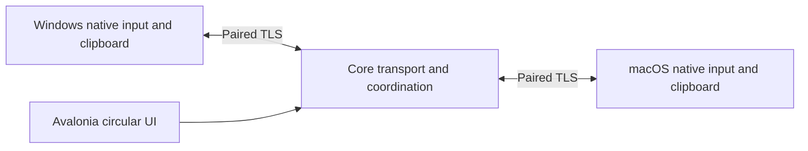

# LinkBridge

[](LICENSE)
[](https://github.com/1127075982ak47-dev/LinkBridge/releases)
[](https://github.com/1127075982ak47-dev/LinkBridge/actions/workflows/ci.yml)

[简体中文](README.md) · **0.0.1 developer preview** · Windows + macOS

### One desk. Two systems.

[Windows x64 and Apple Silicon downloads](https://github.com/1127075982ak47-dev/LinkBridge/releases/tag/v0.0.1) · [Installation](docs/INSTALLING.md) · [Publication audit](docs/security/PUBLICATION-AUDIT.md)

A circular workspace for two computers. Slide your Windows pointer into a Mac, drop a file into Finder, and bring text or images back to the app you are working in.


LinkBridge grew out of a real desk: Windows on the left, a Mac on the right, one keyboard, one mouse, and one set of speakers. The disc brings connection state, device ownership, and current actions together. Its connection curves and moving light are drawn in code and follow the actual connection state.

## A few things to try

- **Move across and keep working.** Cross the Windows right edge to control the Mac. The keyboard follows the pointer; move back to continue on Windows.
- **Pick up a file and drop it into Finder.** Drag from Explorer to a destination folder on the Mac. The default operation is copy, the source stays intact, and completion comes from a real save receipt.
- **Copy material, paste on the other system.** Share plain text and PNG images in both directions. Existing PNG bytes are preserved. Oversized images are rejected rather than quietly reduced in quality.
- **Keep one playback destination.** The shared speaker path can route Mac audio to the Windows output. The UI marks the current system default device.

## What 0.0.1 actually does

| Capability | Status |
| --- | --- |
| Windows-left → Mac-right input; return to Windows | Verified on a real two-computer desk |
| Explorer → Finder file copy | Native drag, destination receipt, and SHA-256 verified; includes nested/empty folders, Unicode names, and empty files |
| Bidirectional plain text and PNG clipboard | Unicode, emoji, newlines, and alpha verified; fixtures include a 3840×2160 PNG |
| Shared speakers on Windows | Existing running path retained; every audio device has not been retested |
| Disc resizing, connection light, circular subpages | Implemented; all window and size combinations have not been exhaustively checked |
| System screenshot region entry point | Integrated; the full button-to-selection UI flow still needs live acceptance |
| Mac → Windows file drag | Not implemented |
| Native 4K camera access and shared microphone | Experimental; drivers, signing, installation, and system approvals remain separate gates |

This is an early project you can try. The 0.0.1 live checks used one paired Windows/macOS setup. They do not establish compatibility with every OS version, screen arrangement, or receiving app. See [verification notes](docs/VERIFICATION.md) for the evidence and limits.

## Run from source

Install the [.NET 10 SDK](https://dotnet.microsoft.com/download/dotnet/10.0). Media features also need [FFmpeg](https://ffmpeg.org/download.html); Mac app packaging needs Xcode Command Line Tools. Platform setup and exact build requirements are in [BUILDING](docs/BUILDING.md).

```sh
dotnet restore LinkBridge.slnx
dotnet build LinkBridge.slnx -c Release
dotnet run --project src/LinkBridge.App/LinkBridge.App.csproj -c Release
```

Configure the trusted peer and grant the current Mac app Accessibility access before using remote input. Keep development previews separate from your authorized daily app, and preserve a stable signing identity when updating that app. The repository contains no pairing secrets, login credentials, or private signing material.

**On your desk:** Windows goes on the left, Mac on the right. Open the destination Finder folder before dragging a file. Use the active system's copy/paste shortcuts. `Ctrl + Alt + M` returns control to Windows in an emergency.

## How the pieces connect



- `LinkBridge.App`: Avalonia workspace and operation feedback.
- `LinkBridge.Input`: Windows capture, Mac injection, screen edges, and disconnect release.
- `LinkBridge.Core`: discovery, pairing, TLS, file transfer, and clipboard protocols.
- `LinkBridge.Media`: audio/video devices and media paths.
- Native boundaries: Windows Explorer/OLE and WASAPI; macOS AppKit, Finder file promises, and NSPasteboard.

Input, files, and clipboard use separate paired channels. Files are checked before Finder supplies their actual destination. Clipboard success is acknowledged after the receiver applies the content to its native clipboard. The TLS statement here does not claim end-to-end encryption for every experimental media path.

## Tested beyond a successful build

```sh
dotnet run --project tools/ClipboardProbe/ClipboardProbe.csproj -c Release
dotnet run --project tools/FileTransferProbe/FileTransferProbe.csproj -c Release
```

**6 clipboard transport groups** and **10 file transport groups** passed, covering wrong credentials and sources, tampering, size limits, cancellation, disconnection, and actual commit acknowledgements. Native Windows/Mac clipboard probes and a real Explorer → Finder workflow were checked separately. PNG bytes and file hashes were independently read on the receiving side. Passing these checks does not prove compatibility with every application.

## Where it could go next

1. **Make the desk reliable.** Broaden OS and app compatibility, long-running checks, and recovery; complete reverse file dragging and screenshot-selection acceptance.
2. **Task handoff.** Bring material, selected text, and a work goal to the other machine, backed by real app capabilities and state.
3. **Desk scene handoff.** Save screen and shared-device arrangements for editing or meetings, then show whether each device is actually ready when switching.

The last two are future concepts, not implemented 0.0.1 features.

## Try it on your desk

Issues and focused PRs are welcome. A useful report includes OS versions, screen arrangement, reproduction steps, and the expected and actual result. Remove credentials and personal information from logs before attaching them.

If you work with Windows OLE, macOS AppKit, native audio/video, or Avalonia, reverse dragging, permissions and signing, and device coordination are good places to contribute.

See [attributions](docs/ATTRIBUTIONS.md) for dependencies, visual assets, and third-party components.
