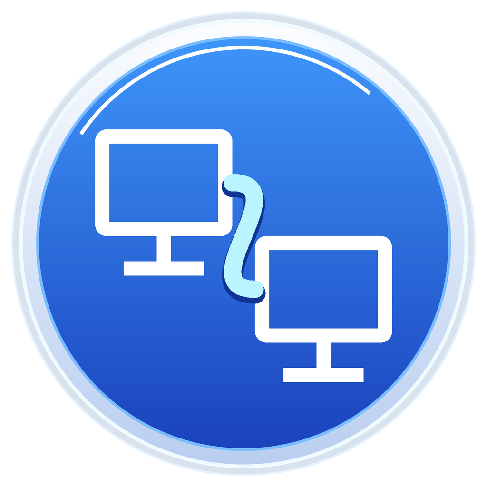
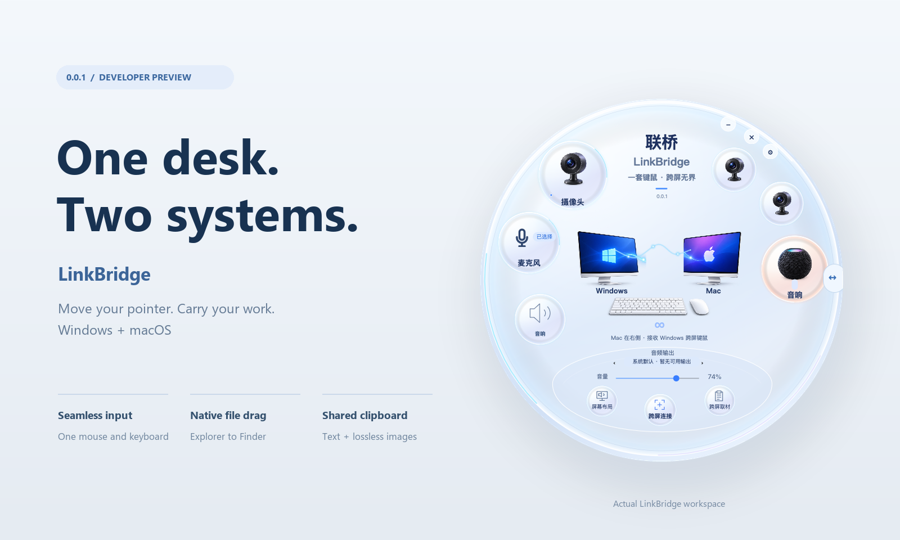
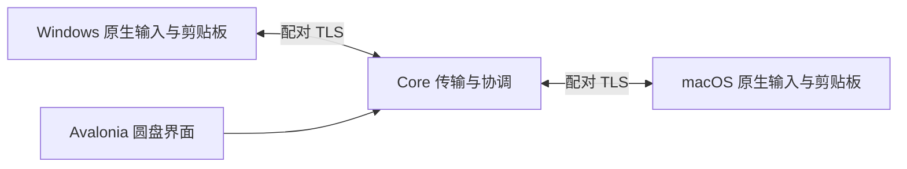

# 联桥 LinkBridge

<p></p>

[](LICENSE)
[](https://github.com/1127075982ak47-dev/LinkBridge/releases)
[](https://github.com/1127075982ak47-dev/LinkBridge/actions/workflows/ci.yml)

[English](README.en.md) · **0.0.1 开发者预览** · Windows + macOS

### One desk. Two systems.

一个圆盘，连接两台电脑。让 Windows 上的鼠标滑进 Mac，把文件放进 Finder，再把文字和图片带回正在工作的应用。



联桥从一张真实的双机桌面长出来：Windows 在左，Mac 在右，一套键鼠、一套音响。圆盘把连接、设备归属和当前动作放在一起；连接曲线与流光由程序绘制，随实际连接状态变化。

## 你可以这样用

- **滑过去，继续操作。** 指针越过 Windows 右边缘进入 Mac，键盘跟随指针；滑回来继续使用 Windows。
- **拿起文件，放进 Finder。** 从 Explorer 拖出文件，跨屏放进 Mac 的目标文件夹。默认复制，源文件保留；完成状态来自实际保存收据。
- **复制素材，换个系统粘贴。** 文字和 PNG 双向共享。已有 PNG 保留原始字节，图片超限时拒绝传送，不偷偷降画质。
- **保留同一套播放设备。** Mac 音频可沿用 Windows 端的共享音响链路，当前系统默认输出在界面中标明。

## 0.0.1 的边界

| 能力 | 当前状态 |
| --- | --- |
| Windows 左屏 → Mac 右屏键鼠；返回 Windows | 已在真实双机桌面验证 |
| Explorer → Finder 文件复制 | 已验证真实拖放、保存收据与 SHA-256；支持嵌套/空目录、中文名和空文件 |
| 双向纯文本与 PNG 剪贴板 | 已验证中文、emoji、换行、透明度；测试包含 3840×2160 PNG |
| Windows 端共享音响 | 已有运行链路；本版沿用，不代表每个音频设备都已测过 |
| 圆盘缩放、连接流光、圆形子页面 | 已实现；尚未穷举全部窗口与尺寸组合 |
| 系统截图选区入口 | 已接入；按钮与框选全过程仍待完整现场验收 |
| Mac → Windows 文件拖放 | 尚未实现 |
| 摄像头原生 4K 应用直用、公共麦克风 | 实验中；仍有驱动、签名、安装和系统批准条件 |

这是一个可试用的早期项目。0.0.1 的验证对象是一组已配对的 Windows/macOS 电脑，尚未覆盖所有系统版本、屏幕组合和目标应用。具体证据与限制见 [验证记录](docs/VERIFICATION.md)。

## 从源码运行

准备 [.NET 10 SDK](https://dotnet.microsoft.com/download/dotnet/10.0)。媒体功能还需要 [FFmpeg](https://ffmpeg.org/download.html)；Mac 应用打包需要 Xcode Command Line Tools。版本与平台安装细节见 [构建说明](docs/BUILDING.md)。

```sh
dotnet restore LinkBridge.slnx
dotnet build LinkBridge.slnx -c Release
dotnet run --project src/LinkBridge.App/LinkBridge.App.csproj -c Release
```

首次运行需要配置受信任的配对电脑，并完成 Mac 对当前应用的辅助功能授权。开发预览与已授权的日常应用应分开；更新日常应用时保持稳定的签名身份。仓库不包含配对密钥、登录凭据或私有签名材料。

**使用时：** Windows 在左、Mac 在右；Mac 先打开目标 Finder 文件夹；复制/粘贴使用当前系统的快捷键。`Ctrl + Alt + M` 可紧急返回 Windows。

## 里面怎么连接



- `LinkBridge.App`：Avalonia 工作区与操作反馈。
- `LinkBridge.Input`：Windows 捕获、Mac 注入、跨屏边缘和断线释放。
- `LinkBridge.Core`：发现、配对、TLS、文件与剪贴板协议。
- `LinkBridge.Media`：音频与视频设备及媒体链路。
- 原生边界：Windows Explorer/OLE、WASAPI；Mac AppKit、Finder file promises、NSPasteboard。

键鼠、文件和剪贴板使用各自的配对传输通道。文件先校验，再由 Finder 提供真实目标位置；剪贴板在接收端完成原生写入后才确认成功。这里的 TLS 描述不等于所有实验媒体流都已实现整体加密。

## 验证，不只看构建结果

```sh
dotnet run --project tools/ClipboardProbe/ClipboardProbe.csproj -c Release
dotnet run --project tools/FileTransferProbe/FileTransferProbe.csproj -c Release
```

已通过 **6 组剪贴板传输测试**与 **10 组文件传输测试**，覆盖错误配对凭据、错误来源、篡改、大小限制、取消、断线与实际提交确认。另有 Windows/Mac 原生剪贴板探针及真实 Explorer → Finder 操作验证；PNG 字节与文件哈希从接收端独立核对。探针通过与所有应用兼容，是两项不同的验收范围。

## 接下来想做什么

1. **先把桌面连稳。** 扩展系统/应用兼容性、长时间运行和错误恢复；完成反向文件拖放与截图选择器验收。
2. **任务接力。** 将素材、选中文字与工作目标交给另一台电脑继续处理，需要真实应用能力和状态支持。
3. **桌面场景接力。** 保存“剪辑”“会议”等屏幕与公共设备组合，切换时显示每个设备的实际就绪结果。

后两项是未来概念，0.0.1 没有实现。

## 一起试一试

欢迎在自己的双机桌面上试用，也欢迎提交 issue 或小范围 PR。报告问题时，告诉我们系统版本、屏幕排列、操作步骤、预期与实际结果；请先去掉日志中的凭据和个人信息。

如果你熟悉 Windows OLE、macOS AppKit、原生音视频或 Avalonia，反向拖放、权限与签名、设备占用协调都很适合一起推进。

依赖、视觉素材及第三方组件说明见 [致谢与归属](docs/ATTRIBUTIONS.md)。
