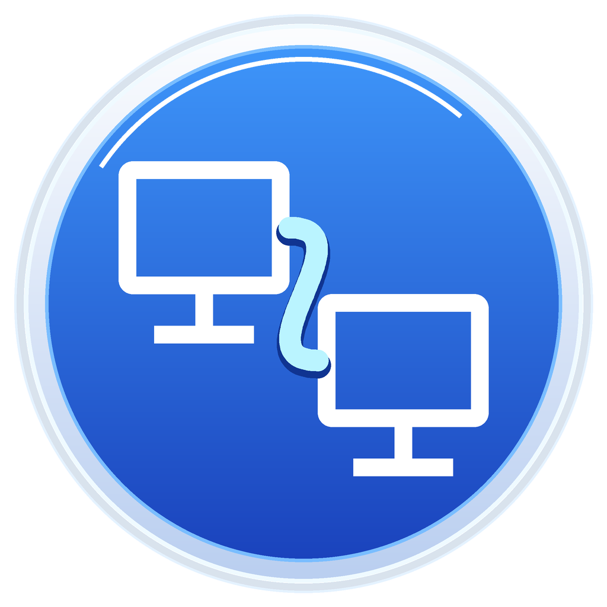
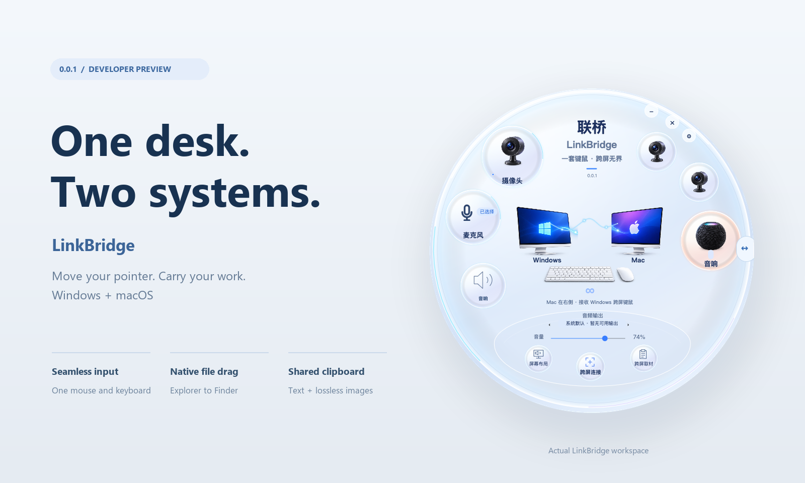

# 联桥 LinkBridge

<p></p>

**0.0.4-beta.1 公测版 · Windows + Apple Silicon Mac** · [English](README.en.md)

一套 Windows 键鼠控制两台电脑，在局域网共享文字、PNG 和文件，并按实际屏幕摆放配置跨机接缝。



## 下载与安装

**[下载公测版与完整朋友试用包](https://github.com/1127075982ak47-dev/LinkBridge/releases/tag/v0.0.4-beta.1)**

完整包包含 Windows 中文安装器、Mac 安装包、离线详细手册、WorkBuddy/Codex 等 agent 的安装交接与脚本、对应源码和测试报告。两端均自带 .NET 运行时，普通使用者不用安装 SDK、Python 或 FFmpeg。

1. 完整解压，打开 `00-先读我.html`。Windows 运行 EXE；Mac 解压对应 ZIP，用终端 `sh Install.command` 安装。
2. Windows 首次配对助手填写两台电脑的局域网 IP，**只生成一组**私有配对文件，退出软件后分别导入两端。
3. Mac 使用者完成真实系统提示和辅助功能授权，启动两端并连接。
4. 打开“屏幕布局”，识别两端屏幕、选择方向与接缝，保存并测试。紧急返回 **Ctrl + Alt + M**。

让本地 agent 安装：把完整解压目录交给它，复制包内 `04-Agent/给Agent的安装指令.txt`。无另一台机器访问能力时，另一端须单独执行；系统授权由本人完成。

[详细使用说明](docs/customer/LinkBridge用户说明书.md) · [Agent 交接规则](docs/agent-install/AGENTS.md) · [测试报告](docs/releases/0.0.4-beta.1/verification.zh-CN.md)

## 本轮范围

| 项目 | 范围 |
| --- | --- |
| 平台 | Windows 11 x64 主控 + macOS 15+ Apple Silicon 被控 |
| 键鼠 | 键鼠接 Windows，控制已配对 Mac；一条可配置跨机接缝 |
| 屏幕布局 | 两端屏幕识别、上/下/左/右、接缝范围、停留时间、保存与恢复 |
| 剪贴板 | 双向文字与 PNG |
| 文件 | 双向文件和文件夹复制粘贴，校验完成后再到目标目录粘贴 |
| 辅助入口 | Windows → Mac Finder 直接拖放；反向直接拖放不在范围 |

音视频、原生相机/麦克风、应用窗口跨屏、磁盘挂载、高级多机、Linux、Intel Mac 和 Windows ARM 不在本轮公测承诺中。新用户默认关闭媒体共享，已有偏好升级时保留。源码或界面存在实验入口不代表完成验收。

这是早期公测：自动传输测试、隔离安装和真实硬件验收分开记录。朋友自己的输入法、多屏、休眠重启、原生文件操作和长期运行仍需实测。

## 签名、权限与数据

Windows 尚无 Authenticode 签名；Mac 使用 ad-hoc 签名，尚无 Developer ID 或公证。首次打开可能出现系统提示，须使用者自行审核；安装脚本不会关闭安全防护。不同既有 Mac 签名要求会拒绝覆盖。

每组电脑生成自己的配对密钥。不要上传配对配置、settings.json、私钥、私人日志或剪贴板内容。SHA-256 清单用于完整性验证，不替代发行者签名。

## 开发与验证

```sh
dotnet build LinkBridge.slnx -c Release
dotnet run --project tools/ScreenLayoutProbe -c Release
dotnet run --project tools/ClipboardProbe -c Release
dotnet run --project tools/FileTransferProbe -c Release
```

构建需 .NET 10 SDK；Mac 原生打包另需 Xcode Command Line Tools 和 Python 3。Windows 发布脚本需要 PowerShell 7.2+，客户安装脚本使用系统 PowerShell 5.1。参见 [构建说明](docs/BUILDING.md)。

本轮完成了双端构建与安装检查、布局/输入/配对/文件/剪贴板协议回归、跨系统 TLS 互通及双端 agent 安装流程。未测项目和辅助工具警告见 [验证记录](docs/VERIFICATION.md)。

代码采用 [MIT](LICENSE)，第三方组件保留各自许可，见 [THIRD_PARTY_NOTICES](THIRD_PARTY_NOTICES.md)。反馈请附系统、芯片、屏幕排列、复现步骤与必要错误信息，并移除个人资料。
