# Mac native 4K camera extension: compile-verified, not installed

This is an original Objective-C CMIO system extension, host and decoder project. It publishes one **3840×2160 BGRA RGB format at exactly 30fps**; it does not advertise 1080, upscale a preview or claim an unsigned endpoint is usable.

## Architecture

```mermaid
flowchart LR
  A[Mac camera app] -->|real source Start / Stop| E[CMIO Extension source]
  E -->|read-only demand property| H[Apple-signed user host]
  H -->|start / heartbeat / stop JSON| D[LinkBridge CAMERA2 coordinator]
  D -->|paired HMAC request and READY| W[Windows native 4K producer]
  W -->|peer-filtered UDP MPEGTS| F[Host FFmpeg decoder]
  F -->|geometry-verified raw BGRA| S[CMIO sink / IOSurface]
  S -->|latest real frame| E
  E -->|3840×2160 sample buffer| A
```



The extension uses real CMIOExtensionProviderSource, DeviceSource and StreamSource protocols. Source and sink streams are named explicitly; the host searches names/UID across scopes rather than assuming legacy direction values. The source counts start/stop demand, exposes `4cc_lbcd_glob_0000`, emits real samples on a host clock at 30fps and clears its latest frame on last stop. Missing/stale content produces **no fabricated sample**.

The sink accepts only `com.linkbridge.camera.host` with an Apple-anchored signature and the same actual Team as the extension. Apple's proxy remains responsible for consuming applications' camera privacy authorization. A custom exact signing identifier is not a TCC bypass.

CMIO sink transport is the supported way to move IOSurface-backed samples between the foreground host and the restricted extension. The extension does not spawn FFmpeg, bind a network listener or invent a cross-user Mach/XPC server. These constraints and the source/sink/custom property APIs are explained in [Apple's WWDC22 session](https://developer.apple.com/videos/play/wwdc2022/10022/).

Buffers are bounded: one latest extension pixel buffer, sink queue3, host CVPixelBufferPool threshold6. Native helper queue-removal callbacks release its retained samples. Root consumer/queue behavior still requires installed-platform tests with actual apps.

## Build and offline verification

On a Mac with Xcode/macOS SDK:

```sh
sh tools/MacCameraBuild/build.sh
sh tools/MacCameraProbe/probe.sh
sh tools/MacCameraProbe/probe.sh --decode /absolute/path/to/ffmpeg
```

Default output is `artifacts/mac-camera-unsigned/LinkBridgeCameraHost.app`, with the extension embedded under `Contents/Library/SystemExtensions/`. This script **does not codesign, create/import identities, modify trust, activate or install**. On arm64 the linker adds its mandatory ad hoc Mach-O signature; this is a linker signature, has no Apple Team, does not seal the app and is not a deployment signature. `UNSIGNED.com.linkbridge.camera` is an explicit packaging placeholder, never an Apple Team claim.

Verified on the actual Mac using Xcode/macOS27 SDK with ARC/blocks, Wall/Wextra/Werror: extension, host, native format/queue probe and native UDP decoder probe compile without warnings. See [evidence](evidence/mac-2026-10-02.txt).

The tests created actual 4K IOSurface/CMSampleBuffers and CMIOExtensionStreamFormat, retained only the latest of20 samples, rejected1080, checked queue3 overload and cleared offline data. Random-port synthetic hardware H264 MPEGTS was decoded to3 actual 4K BGRA frames; a real1080 UDP stream emitted0 accepted4K frames and was rejected. These are synthetic transport/format tests, **not installed virtual-camera application tests**. No physical camera, GUI, TCC or service activation was used.

## Native host API for the coordinator

Fixed production bundle: `/Applications/LinkBridgeCameraHost.app`.

| Mode | Purpose |
| --- | --- |
| `--status` | Read-only JSON; native device found/status and exact format |
| `--check-activation` | Read-only eligibility; real Apple Team, bundle location and embedded extension prerequisites |
| `--activate` / `--deactivate` | Explicit OSSystemExtensionRequest flow; do not execute without the legal signing/install/user gate |
| `--observe` | Demand JSON observation only |
| `--bridge PEER_IP UDP_PORT FFMPEG_ABSOLUTE_PATH` | Demand-driven native sink feed through a peer-filtered 4K decoder |

`--bridge` emits UTF8 JSON lines containing v1, `start` / `stop` / `heartbeat`, a native generation UUID and consumer count. `start` includes width3840, height2160, fps30 and the receive port. Error records report real sink/decoder failure. Heartbeats can recover a dropped initial event; the controller already knows the configured port and peer. `framesDelivered` counts samples actually sent by the extension source, and `freshFrames` requires a source sample timestamp within two seconds; authenticated READY alone does not prove camera frames. Device discovery checks actual native source/sink BGRA3840×2160 format and actual 30fps before `found=true`.

The host receives no shared key. The parent must call existing authenticated CAMERA2 control and only after a valid READY send:

```json
{"v":1,"event":"pairedReady","generation":"current-helper-generation-UUID"}
```

A revoked source is disabled with `pairedStopped` using the same generation. Old-generation lines cannot enable a new session. Raw decoded frames are gated by this parent confirmation. This local control channel is inherited stdin from the owning parent, not an unauthenticated network interface.

The FFmpeg receiver has no scale filter. It requires native4K initial metadata **and per-frame showinfo geometry**, preventing initial or later non4K frames from being mislabeled. One fixed raw frame buffer is reused; the read worker uses a duplicated FD plus generation checks so retired readers cannot consume a newly opened pipe. UDP idle8s, current consumer decoder retry2s, source stale1s, synchronous owned-child kill on stop/stdinEOF/signal, and nonblocking status output keep cleanup bounded. UDP video remains unencrypted; CAMERA2 controls use paired authentication in the parent.

Do not launch a build-directory unsigned helper as production. Its `--status` currently returns found=false. The current host preflight reports no Apple Team and no `/Applications` installation, so activation was not attempted.

## External conditions still required

1. A legitimate Apple signing identity/Team and matching host/extension capabilities, group identifier, entitlements and signing identity. The host and system extension must satisfy the same-Team and App Store/notarization conditions in [Apple System Extensions](https://developer.apple.com/documentation/systemextensions).
2. Replace the build placeholder with the actual configured Team-prefixed App Group; sign nested code inside out and seal/verify the complete host bundle. This project does not create certificates or connect an Apple account.
3. Install the signed host in `/Applications`; explicitly submit activation and obtain administrator approval. Apple's [camera extension guide](https://developer.apple.com/documentation/coremediaio/creating-a-camera-extension-with-core-media-i-o) explains the capability, embedding and activation requirements.
4. Users grant consuming apps their normal camera access. Do not disable SIP, edit TCC, remove sandboxing or weaken signature validation.
5. Integrate the native host observer/bridge with the existing LinkBridge discovery/paired controls and Windows native4K producer. Prove exact format, real pixels, two consumers, stop/reconnect, refusal and bounded buffers using the installed framework.

Only after these conditions and actual application tests can the main UI mark Mac native shared-camera input available. The current compiled source is progress toward that gate, not completion of Windows→Mac app camera sharing.
